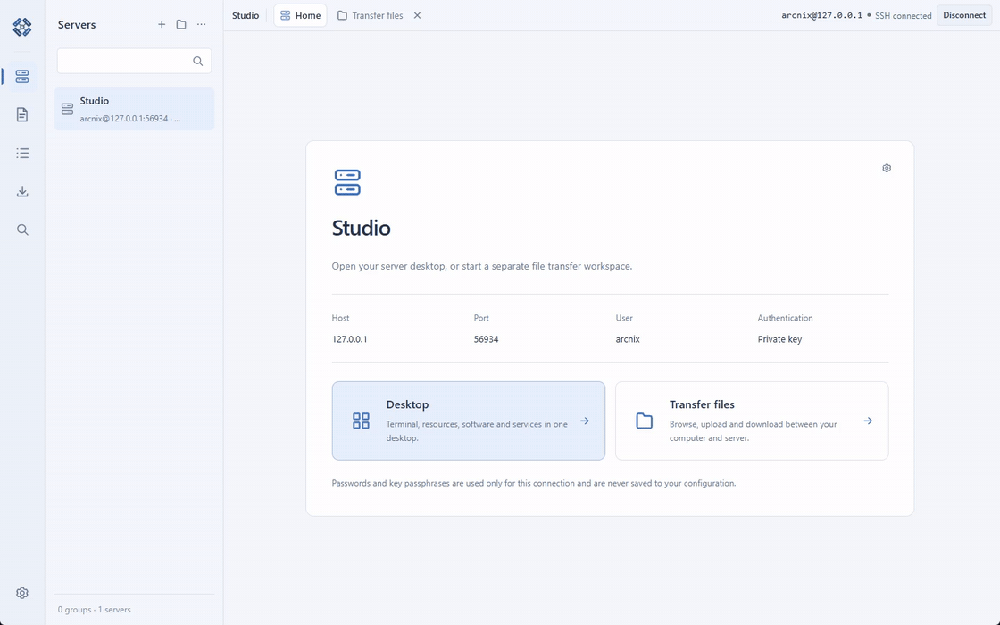
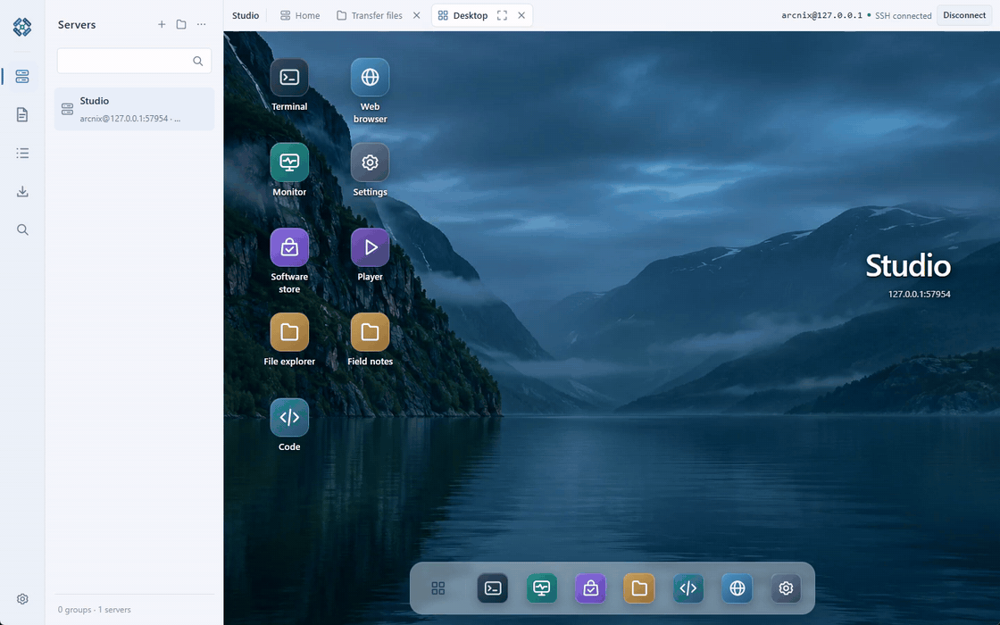
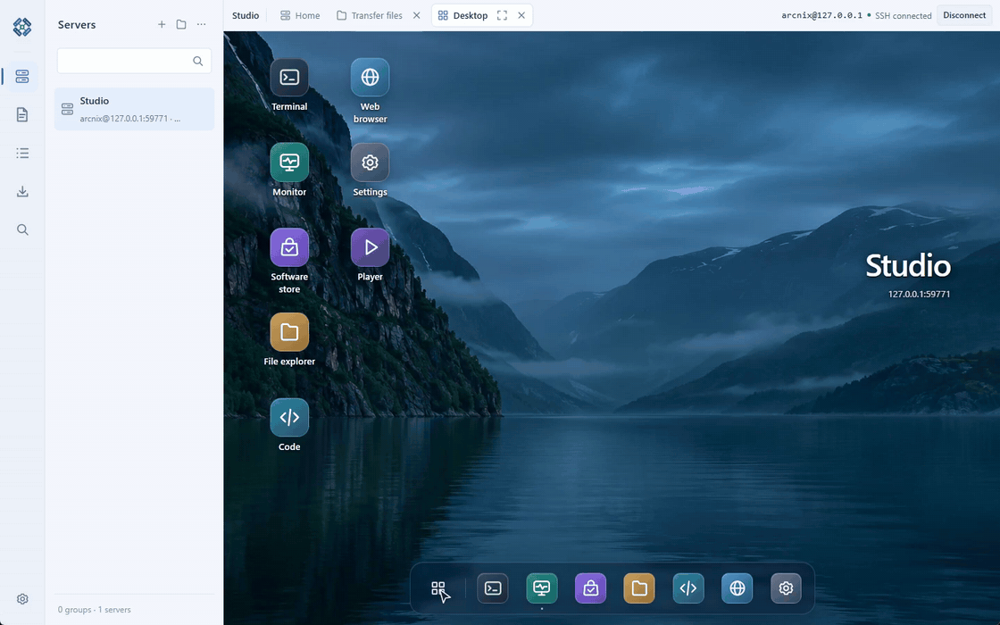
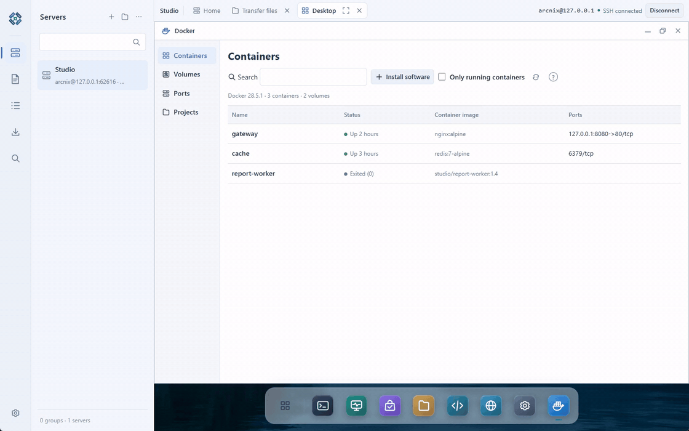

# Arcnix

[简体中文](README.zh-CN.md) · [Download](https://arcnix.org/#downloads) · [Quick start](https://arcnix.org/docs/quick-start/) · [Documentation](https://arcnix.org/docs/)

Arcnix is a desktop app for managing Linux servers over SSH. The interface runs on your computer. Arcnix uses your SSH account to open shells and run server commands, and SFTP to read and write remote files. The server needs an SSH service. It does not need an Arcnix agent.

## What you can do

- **Files and code.** Transfer files between your computer and the server, edit remote text and preview Markdown. On Windows x64, stream remote MP4 and MKV files.
- **Terminal.** Open an interactive shell in a remote folder or use the terminal inside the editor.
- **Monitoring and Docker.** Check resource usage, services and logs. Inspect containers, ports and volumes on Docker hosts.
- **Tasks and backups.** Review scripts across hosts, check the results of server-owned tasks and restore files from restic snapshots.

Desktop downloads are available for Windows x64, macOS on Apple Silicon, and Linux x64 and ARM64.

## Feature demos

### SFTP file transfer

Upload a local file, pause and resume the transfer, then download a file from the server.

### Remote code editing

Edit a Markdown file on the server, save it and open the preview beside the source.

### Server monitoring

Check network throughput, then open the Services tab to read Nginx logs.

### Docker

Start a stopped container and inspect its logs, volume mounts and port mappings.

[Development](docs/development.md) · [Changelog](CHANGELOG.md) · [Apache-2.0 license](LICENSE)
