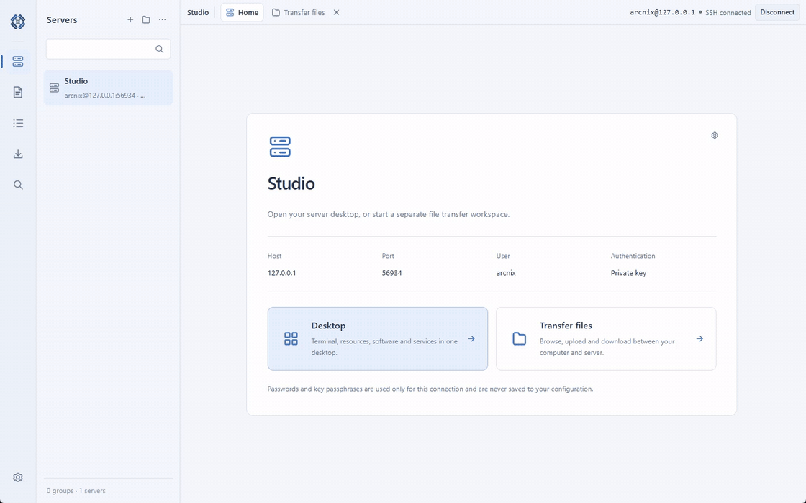
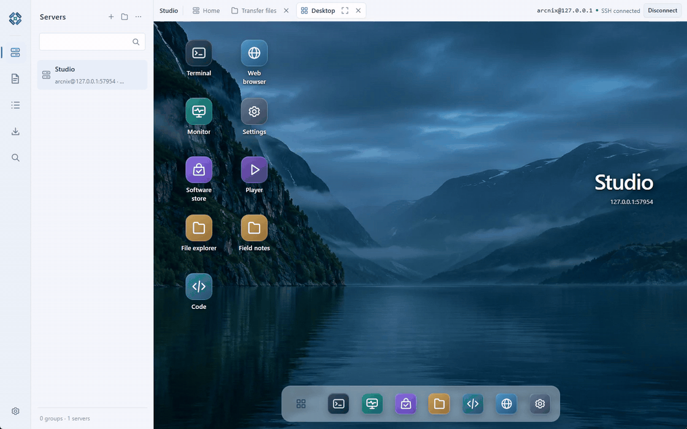
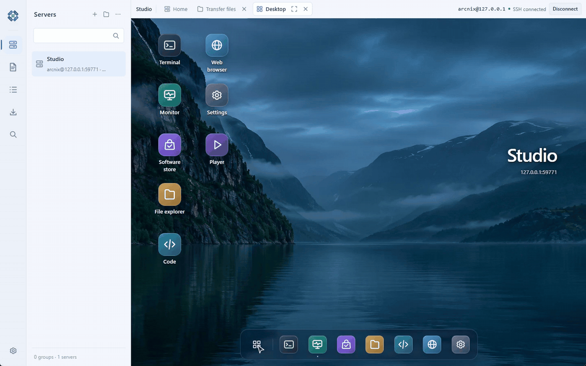
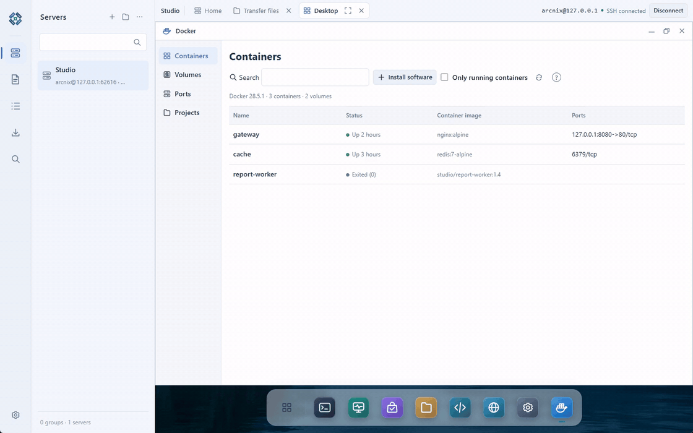

# Arcnix

[English](README.md) · [下载](https://arcnix.org/zh-cn/#downloads) · [快速上手](https://arcnix.org/zh-cn/docs/quick-start/) · [使用文档](https://arcnix.org/zh-cn/docs/)

Arcnix 是一个通过 SSH 管理 Linux 服务器的桌面应用。界面运行在你的电脑上，终端和管理命令使用你的 SSH 账号在服务器上执行，远程文件通过 SFTP 读写。服务器开启 SSH 即可连接，无需安装 Arcnix 服务端。

## 主要功能

- **文件与代码**　在本机和服务器之间传输文件，直接编辑远程文本、预览 Markdown。Windows x64 还支持播放远程 MP4 和 MKV。
- **终端**　在指定远程目录打开交互式终端，也可以在代码编辑器里使用终端。
- **监控与 Docker**　查看资源用量、服务和日志。在运行 Docker 的服务器上检查容器、端口和卷。
- **任务与备份**　在多台服务器上审核并运行脚本，查询已提交任务的结果，从 restic 快照恢复文件。

客户端提供 Windows x64、macOS Apple Silicon，以及 Linux x64 和 ARM64 下载包。

## 连接本机 WSL（Windows）

在「新建服务器」中点击「选择本机 WSL 发行版」。列表显示运行状态，选中后会启动该发行版并填入默认 Linux 用户名。填写发行版的 SSH 端口，选择密码或私钥，保存后连接。终端命令和文件修改会直接作用于这个发行版。

发行版需要运行 OpenSSH Server，且 Windows 能通过 `127.0.0.1` 访问该端口。在使用 systemd 的 Ubuntu 或 Debian 中，可以用 `systemctl status ssh` 查看服务状态，并用 `ss -ltn` 检查监听端口。只供本机使用时，可将 sshd 的 `ListenAddress` 设为 `127.0.0.1`。多个发行版同时使用时，请分别配置端口和主机密钥。Arcnix 在发送凭据前会与所选发行版的 `/etc/ssh/ssh_host_*_key.pub` 核对公钥。

## 功能演示

### SFTP 文件传输

上传本地文件，在传输队列中暂停和恢复上传，再从服务器下载文件。

### 远程代码编辑

编辑并保存服务器上的 Markdown 文件，在源码右侧查看渲染效果。

### 服务器监控

查看网络吞吐量，再切换到服务页面读取 Nginx 日志。

### Docker

启动已停止的容器，查看容器日志、卷挂载和端口映射。

[开发说明](docs/development.md) · [更新记录](CHANGELOG.md) · [Apache-2.0 许可证](LICENSE)
